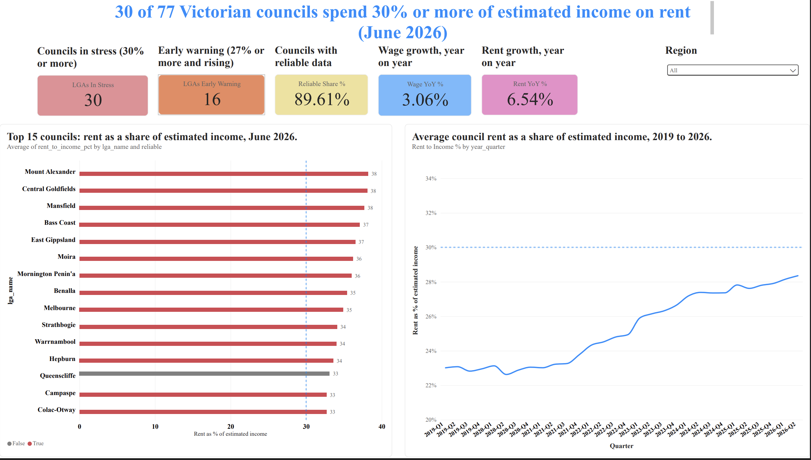

# Victorian Rental Stress Tracker

**Which Victorian councils are becoming unaffordable for renters, how fast, and where is it heading next?**

A data project built on real Australian government data. It turns three public datasets into an early-warning dashboard that shows where renters are under the most pressure, and which councils are likely to be next.

> **Author:** Yash Deshmane | **Walkthrough video (3 min):** [add link] | **Dashboard PDF:** [`docs/Victorian_Rental_Stress_Dashboard.pdf`](docs/Victorian_Rental_Stress_Dashboard.pdf)



---

## The 30-second version

When rent takes **30% or more of a household's income**, it is widely treated as a sign of *housing stress*: there is less left for food, power, transport and savings.

I compared what it costs to rent in each of Victoria's 79 councils with an estimate of what households there earn. For June 2026:

| | Councils |
|---|---|
| **In stress** (rent is 30% or more of estimated income) | **30** |
| **Early warning** (27% or more, and rising on last year) | **16** |
| **Stable** | **31** |

*(77 councils had a June 2026 rent figure. Two small rural councils had too few new rentals to report.)*

---

## Why this matters

Rent is the biggest bill most renters have. Housing teams, councils and community organisations need to decide where to put tenancy support, advocacy and new housing. Today that often means reading a static quarterly report and relying on instinct.

This project answers three practical questions:

1. **Who is under the most pressure right now?**
2. **Is it getting worse, and how quickly?**
3. **Which councils should we watch next?**

---

## What I found

**1. Rental stress is widespread, and strongest in regional Victoria.**
The five highest councils are Mount Alexander (38.2%), Central Goldfields (38.1%), Mansfield (37.7%), Bass Coast (37.1%) and East Gippsland (36.5%). In plain terms, in Mount Alexander about **$38 of every $100** of household income goes on rent. Melbourne's city council is also above the line, at 34.9%.

**2. Rents are rising faster than pay.**
Average council rents rose about **6.5%** over the year to June 2026, while Victorian wages rose about **3.1%**. That gap is why the burden keeps climbing. *(Rent growth is an average of council medians, not a statewide median.)*

**3. It is a long-running trend, not a blip.**
Across all councils, rent as a share of estimated income rose from roughly 23% in 2019 to roughly 29% in 2026.

**4. More councils are heading towards the line.**
A simple four-quarter forecast flags **6 more councils** (5 on early warning, 1 currently stable) that are likely to cross 30% within a year.

**5. The headline number depends on assumptions, so I tested it.**
If household incomes are 5% lower than my estimate, **40** councils are over the line. If they are 5% higher, **20** are. The honest summary is "around 30, within a range of about 20 to 40".


---

## What I recommend

- **Prioritise tenancy support and advocacy** in the regional councils at the top of the list.
- **Watch the 6 councils flagged by the forecast.** Acting before they cross the line is cheaper than acting after.
- **Track the gap between rent growth and wage growth** each quarter. It is the clearest early signal.

---

## How I built it, in plain English

1. **Collected three public datasets.** What rent costs, what households earned, and how fast pay has grown since.
2. **Cleaned them.** I found three summary rows mixed in with the councils, and three councils spelled differently in different files. I fixed these and kept a record.
3. **Estimated today's income.** The latest income data is from the 2021 Census. I grew each council's 2021 income by the rise in Victorian wages since then.
4. **Calculated rent as a share of income** for every council and quarter, and sorted councils into In stress, Early warning and Stable.
5. **Forecast four quarters ahead**, then tested the forecast by hiding the last four known quarters and checking how close it got. The typical miss was about **2.7%**.
6. **Built a four-page dashboard** so anyone can explore the results.
7. **Added AI-written summaries with a safety check.** The AI only sees my calculated numbers, and a script checks that every number in its text can be traced back to the data. Anything that fails is held back.

---

## The dashboard

| Page | What it answers |
|---|---|
| **1. Overview** | How bad is it, and is it getting worse? Headline numbers, the 15 most stressed councils, and the trend over time |
| **2. Council drill-down** | What is happening in one council, and where is it heading? History, forecast, and rents by home type |
| **3. Early-warning list** | Who should we act on first? All 77 councils ranked, plus the watchlist of councils forecast to cross 30% |
| **4. Method and data quality** | Why should I trust this? Sources, calculation, limits, data checks, and the sensitivity test |


---

## Key terms

| Term | Meaning |
|---|---|
| **Rent-to-income ratio** | Weekly rent divided by weekly household income |
| **Housing stress** | Rent at 30% or more of income (a widely used rule of thumb, not a law) |
| **Early warning** | At 27% or more, and higher than a year ago |
| **Reliable data** | A council's rent figure rests on 30 or more new rental agreements |
| **Median** | The middle value, so a few very expensive or cheap homes do not distort it |

---

## Can I trust it? What this does not tell you

I would rather be upfront about the limits.

- **Rents are for new rental agreements.** These are often higher than what long-term tenants pay, so stress may be overstated.
- **Income is an estimate.** The latest council-level income data is from 2021, so I grew it using statewide wage growth. Real councils will differ.
- **Median household income covers all households**, including home owners. Renters often earn less than the average, so stress may be understated. The two effects pull in opposite directions.
- **Councils are averages.** A council can contain both very comfortable and very stressed suburbs.
- **About 1 in 10 councils** (8 of 77) have fewer than 30 new rentals behind their figure, so treat those as indicative.
- **The forecast extends the recent trend.** It does not know about interest rates, new supply or policy changes.

---

## For technical readers

### Tech stack

| Layer | Tools |
|---|---|
| Language | Python 3.11 (pandas, statsmodels, openpyxl, requests) |
| Database and SQL | DuckDB, with layered SQL (staging, star schema, mart, analysis) using CTEs and window functions |
| Dashboard | Power BI (semantic model, DAX measures, Power Query) |
| AI | Claude API (`claude-sonnet-5-5`) with programmatic output verification |
| Automation | GitHub Actions (scheduled brief refresh), one-command pipeline script |
| Version control | Git and GitHub |
| Editor | VS Code |

### Data sources

| Dataset | Source | Used for |
|---|---|---|
| Quarterly median rents by council, with new-letting counts | Victorian Department of Families, Fairness and Housing, Rental Report (June quarter 2026) | The cost of renting |
| Median weekly household income by council | ABS Census 2021, General Community Profile table G02 | Starting income |
| Wage Price Index, Victoria | ABS, Table 2b (June 2026) | Growing income forward from 2021 |

Raw files are not stored in this repo. See [`data/raw/README.md`](data/raw/README.md) for download links. Check each source's licence and terms before reuse.

### How the calculation works

```
estimated income = Census 2021 income x (wage index now / wage index Sep 2021)
rent-to-income   = median weekly rent / estimated income
```

The wage index rose from 139.2 (September 2021 quarter) to 161.5 (June 2026), a multiplier of about 1.160.

### Architecture

```
Raw files (DFFH, ABS)
   -> Python ingestion (clean, reshape)
   -> DuckDB staging tables
   -> SQL star schema (dim_lga, dim_date, fact_rent, fact_income, fact_wage)
   -> SQL mart (rent-to-income) and analysis (early-warning list)
   -> Python forecast with backtest, plus sensitivity test
   -> Power BI semantic model and 4-page dashboard
   -> Claude API briefs with number verification
```

### Repository structure

```
src/                Python scripts (ingest, validate, export, forecast, briefs, pipeline)
sql/                Layered SQL: 01_staging, 02_model, 03_mart, 04_analysis
reference/          LGA name mapping used to join sources
data/processed/     Model outputs (CSV) and forecasts
powerbi/            Workbook used to load the Power BI model
docs/               Methodology, data dictionary, decisions, data quality, AI governance, memo, screenshots
.github/workflows/  Scheduled AI-brief refresh
```

### How to run it

```bash
git clone https://github.com/yashkd-fresher/vic-rental-stress.git
cd vic-rental-stress
python -m venv .venv
source .venv/bin/activate
pip install -r requirements.txt
# download the raw files into data/raw as described in data/raw/README.md
python src/run_pipeline.py
```

The pipeline stops if any validation check fails. To generate AI briefs, set `ANTHROPIC_API_KEY` in your environment (never commit it) and run `python src/briefs.py`.

### Data quality and validation

- Three summary rows (Metro, Non-Metro, Victoria) were mixed into the council rows. They are tagged and kept out of council analysis.
- Three council names differed between sources (Colac-Otway, Mornington Peninsula, and Merri-bek, which is the renamed Moreland). A mapping file bridges them.
- Loddon and West Wimmera have no June 2026 median and are excluded from the latest-quarter list and the forecast.
- Automated checks cover council count, missing income, plausible ratio ranges and the wage base quarter.
- I hand-checked Mount Alexander: $555 rent divided by $1,453 estimated income is 38.2%, matching the pipeline and the dashboard.

### The AI layer

The model receives only structured numbers for each flagged council and writes three sentences. A script then extracts every number from the text and checks it against that council's data. Briefs with untraceable numbers are excluded, and I read all of the rest by hand. Pass rate: **[X]%**. Details are in [`docs/ai_governance.md`](docs/ai_governance.md).

### Automation and refresh

A GitHub Action refreshes the AI briefs each quarter, with the API key held as a secret. The data refresh is a short manual checklist, because source links change each quarter and a person should review new data before it is published:

1. Download the new rental workbook and wage table into `data/raw`.
2. Run `python src/run_pipeline.py` and confirm validation passes.
3. Check for new name mismatches.
4. Run `python src/briefs.py` and review any failed checks.
5. Refresh the dashboard data and commit.

### Skills demonstrated

Advanced SQL (CTEs, window functions, star schema), Python data engineering, data validation, time-series forecasting with backtesting, sensitivity analysis, Power BI modelling and DAX, dashboard design, applied AI with verification, Git and automation, and plain-language communication of results.

---

## What I would do next

- Add **suburb-level** analysis, since councils hide big differences within them.
- Use **newer income data** when the next Census is released.
- Add **automated tests** for row counts and joins.
- Interview a housing-service user to refine which measures matter most.

---

## Documentation

| File | Contents |
|---|---|
| [`docs/methodology.md`](docs/methodology.md) | Definitions, formulas, thresholds, sensitivity results |
| [`docs/data_dictionary.md`](docs/data_dictionary.md) | Every table and column |
| [`docs/decisions.md`](docs/decisions.md) | Why I chose each approach |
| [`docs/data_quality.md`](docs/data_quality.md) | Problems found and how I fixed them |
| [`docs/ai_governance.md`](docs/ai_governance.md) | Prompt, verification, pass rate, review rule |
| [`docs/dax_measures.md`](docs/dax_measures.md) | The Power BI measures |
| [`docs/insight_memo.pdf`](docs/insight_memo.pdf) | Two-page summary for a non-technical reader |

---

## About

Built by **Yash Deshmane** as an end-to-end data analyst portfolio project using real Australian data. Feedback is welcome.

**LinkedIn:** [add link] | **GitHub:** [yashkd-fresher](https://github.com/yashkd-fresher)
